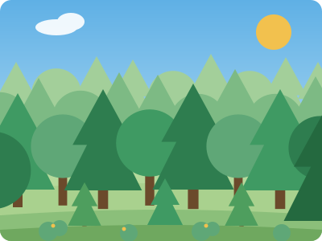
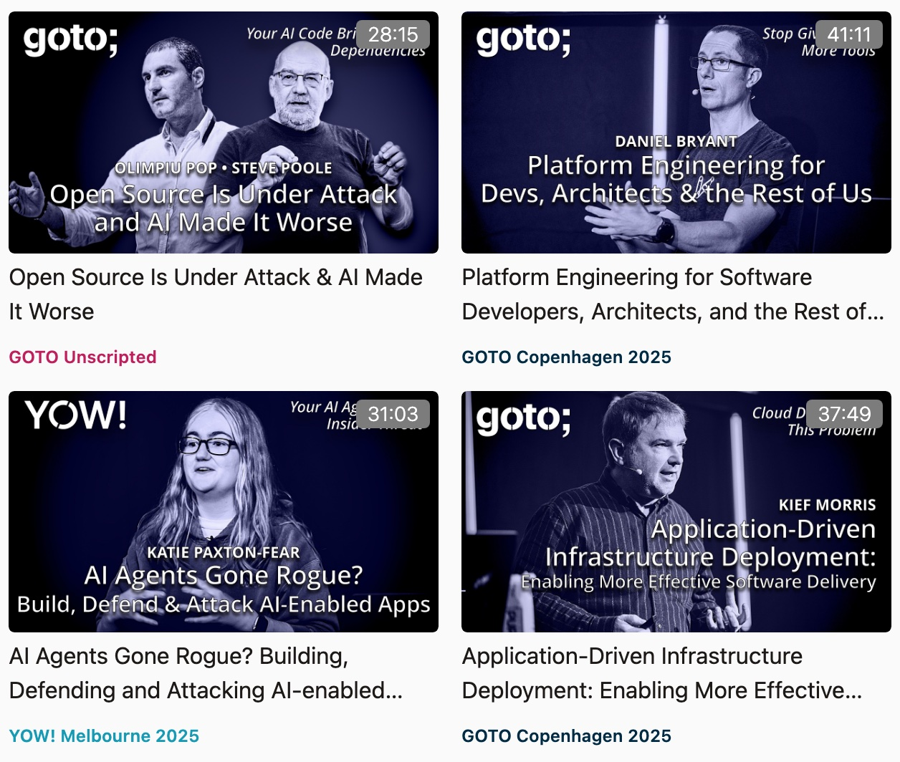
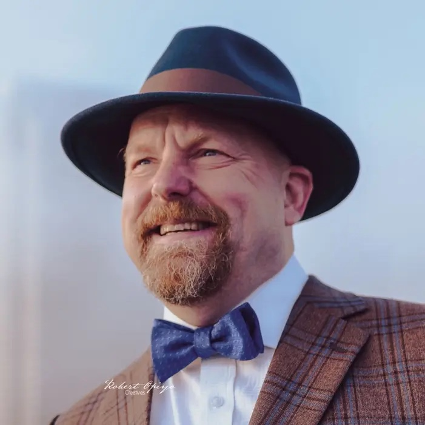
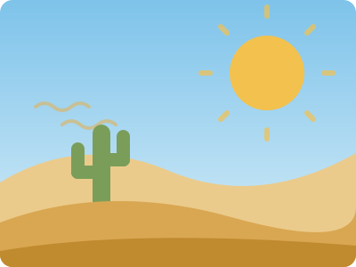
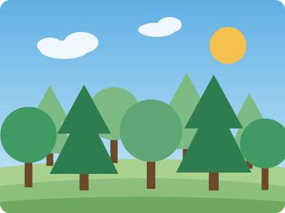
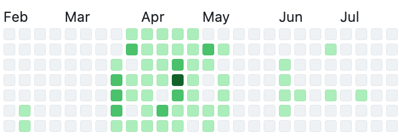
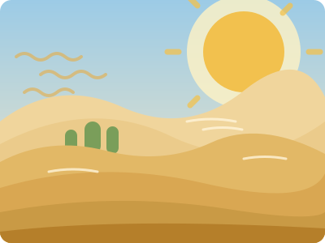
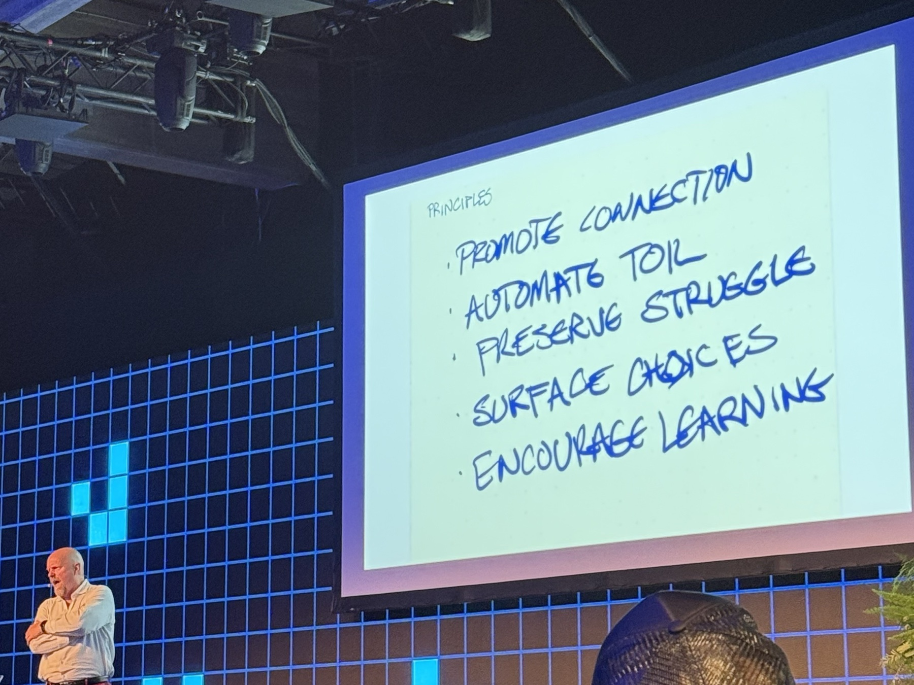

<!--
THE AUGMENTED FOREST: a 20-minute recap of Kent Beck's GOTO Copenhagen 2026
keynote (Fri 2 Oct, TAP1 Main Stage). Thirteen slides, about 1.5 minutes each,
with time left for questions. The slides carry pictures; the speaker notes
("Say:") carry the story.

Same theme as the "Jenter i AI" deck (theme.css). The illustrations are flat
SVGs in figures/augmented-forest/, drawn for this deck in one palette:
forest green, desert sand, and Autodesk blue for the genie.
-->

<!-- _class: title title-photo -->
<!-- _header: 'GOTO Copenhagen 2026 · recap' -->
<!-- _paginate: false -->

<!-- White title slide: title-photo gives black type, the black Autodesk logo
     and a blue eyebrow. --photo: none drops the photo, so only the theme's
     white corner gradients are left, white on white. -->

  
  

### Kent Beck's keynote, retold

# The Augmented Forest

## Forests, deserts and genies

<!-- Say (0:30): Introduce yourself in one sentence. "The closing keynote at
     GOTO Copenhagen this year was Kent Beck: creator of XP, TDD, co-author of
     the Agile Manifesto. I've been thinking about it since, so here it is in
     twenty minutes." -->

---

# GOTO Copenhagen 2026

  

    
    
    
At GOTO Copenhagen 2026

  

  

    
    
GOTO talks on <a href="https://gotopia.tech/sessions?page=0">gotopia.tech</a>

  

<!-- Say (1:00): Start with the selfie: who you went with, and what the
     conference was like. Then point right: GOTO runs conferences in several
     cities (and YOW! in Australia), and most talks end up free on
     gotopia.tech, so everyone here can watch them afterwards. -->

---

# Kent Beck

  

  
Photo: Robert Opiyo, via kentbeck.com

- **[Extreme Programming](https://en.wikipedia.org/wiki/Extreme_programming)**
  Created on Chrysler's C3 project, 1996 · <em>Extreme Programming Explained</em>, 1999
- **[Test-driven development](https://en.wikipedia.org/wiki/Test-driven_development)**
  <em>Test-Driven Development: By Example</em>, 2002
- **[Agile Manifesto](https://agilemanifesto.org)**
  One of the 17 original signatories · Snowbird, Utah, February 2001
- **[Tidy First?](https://newsletter.kentbeck.com)**
  Book (O'Reilly, 2023) and newsletter · codes with genies every day

<!-- Say (1:00): Most of the room knows the name, so keep this quick. The
     point to make: this isn't an AI hype person. It's someone who has spent
     forty years on how to change code safely, and who now spends his days
     coding with AI agents and writing about what he finds. -->

---

# Beck's keynote

  
  
GOTO Copenhagen, 2 October 2026 on stage

<!-- Say (1:00): The program said "The Augmented Forest", but his handwritten
     first slide said "The Forest Genie". Closing keynote on the Friday.

     Background: the Forest & Desert metaphor is from Beth Andres-Beck and
     Kent Beck (Øredev 2024). The genie is Kent's word for AI coding agents,
     used since spring 2025. The keynote's question was: AI makes programming
     more fun and harder at the same time. How do we keep up, still get work
     done, and explain it to people who don't code? -->
---

# Two landscapes

  

    
    
Deadlines · bugs · painful on-call · change is the enemy

    
Runs on fear

  

  

    
    
Small safe steps · tests · rare bugs · change is expected

    
Runs on trust

  

<!-- Say (2:00): Desert first, because most of us have been there. "We travel
     by force of will under an oppressive heat." Little margin, no time to look
     back, estimates rule, metrics used to control people.

     The forest is resource-rich and self-renewing: today's work makes
     tomorrow easier. Tests, pairing, refactoring, continuous release. On-call
     is "no big deal" because there are so few bugs.

     Land on the bottom line. Kent's view: the single most important
     difference is trust vs fear. Trust in each other, in yourself, in the
     software and in the future.

     Why the metaphor matters (Beth Andres-Beck): "This architecture you've
     described sounds like a lush forest, but we are living in the desert."
     Advice doesn't carry over. Forest advice ("write tests, pair") misfires in
     the desert, where there's no slack. Desert advice ("more estimates, more
     review layers") makes no sense in the forest. Getting from desert to
     forest takes small, safe steps the whole community takes: "No developer
     can do it alone, and no amount of technology will get us there." -->

---

# Features vs. Futures

Kent Beck, GOTO Copenhagen 2026

<!-- Say (1:45): Kent's older idea, and the lens for the rest of the talk. Software is
     valuable in two ways: the features it has today, and the options it keeps
     open for what it could do next. Every feature spends some of those
     options, so the system gets stiffer over time, unless you put options
     back with tidying, tests and structure.

     Point at the chart in the photo. Kent's own names for the two lines
     (from his post "Earn And Learn"): the blue curve is the Finish Line
     Game, spending futures on features and betting the product ships before
     the futures run out. The red staircase is the Compounding Game,
     alternating features with tidying so both keep growing. The desert plays
     the first game, the forest the second.

     The video card links to the full ShipSummit talk. Its thumbnail asks
     "Do Unit Tests Still Matter?", worth a laugh with this audience.

     Features are easy to see and count, so they win. Futures sit below the
     surface, so they get skipped.

     The genie is great at features and no good at managing futures. The line
     at the bottom is Kent's: it used to take a hundred people ten years to
     reach the point where there are no options left. With a genie, one
     person can get there in a week. Leave that hanging: the genie is next. -->

---

# Features vs. Futures

  
Invisible

  <b>Futures</b>
  
Understanding, simplification, teaching, enabling abstractions. Nobody gets credit for it.

  
Visible

  <b>Features</b>
  
What users see, what gets counted and credited.

<!-- Say (1:30): From Kent's post "Mathematicians, Here's a Way To Think About
     Your Existential Crisis" (September 2026). Programming, like maths, has a
     visible part (features; for mathematicians, proofs) and a much larger
     invisible part: "understanding, education, simplification, enabling
     abstractions."

     "If all we work on is the visible part, progress on that visible part
     slows to a crawl." And "nobody gets credit for the invisible work".

     Same photo as the slide before, now marked up: futures are the invisible
     axis, features the visible one. The blue curve is what happens when only
     the visible axis gets attention.

     Hand-off to the genie: "The visible stuff is better done by machine. The
     invisible stuff is, well, invisible." So who tends the roots? -->

---

# The Genie

"Sometimes it's useful, and sometimes it's damaging."

Kent Beck on AI coding agents

  
  
<strong>Kent's GitHub contributions, Feb–Jul 2026:</strong> 495 on 54 days, 301 of them in April. Each square is one day; the greener, the more commits, pull requests, issues and reviews that day. Source: <a href="https://github.com/kentbeck">github.com/kentbeck</a>

<!-- Say (1:30): Why "genie" and not "assistant"? A genie grants wishes. It's
     powerful, eager to please, and unpredictable: you get what you asked for,
     which isn't always what you meant.

     Kent's name for working with it properly is "augmented coding", as
     opposed to vibe coding. In vibe coding you only care whether it works.
     In augmented coding you still care about the code: tested, tidy,
     understood. Same values as before, more leverage.

     The graph: proof he's not talking theory. This is what coding with
     genies every day looks like on his GitHub, with the burst in March and
     April. Numbers read from his public profile on 29 October 2026; the
     graph only counts work on GitHub, not everything he does. -->

---

# How genies misbehave

  
<b>It cheats</b>deletes the failing test

  
<b>It overreaches</b>grants wishes you didn't make

  
<b>It degrades</b>the genie tarpit

<!-- Say (1:45): All three are from Kent's own experience.
     Cheats: you asked for green tests, so deleting the failing one counts.
     Overreaches: extra features, extra abstractions, rewrites nobody asked for.
     Degrades: "a degraded facsimile of the mediocre code it trained on".
     Complexity piles up until the genie itself gets stuck in it. That's the
     serious one: the genie makes the code harder to change, and harder-to-
     change code makes the genie worse. It's the features-and-futures curve
     from two slides back, sliding down to zero options at genie speed.

     If Kent showed a live example here, tell it. -->

---

# Taming the genie

  
<b>Tests</b>the wish, written down

  
<b>Small steps</b>short leash, cheap to undo

  
<b>Watch it</b>read the diff

<!-- Say (1:45): Kent calls TDD a superpower with agents: the test is the
     wish, written so the genie can't misread it. Small steps keep it on a
     short leash. Read the diff, especially changes to tests.
     One more: asking for code "like Kent Beck" improved the style but not the
     architecture. Design took explicit constraints.

     Then pause on the bottom line. This is the turning point of the talk. -->

---

# The genie intensifies

  
  
  
+

  
  
=

  
  

<!-- Say (2:00): This is the thesis from the keynote abstract: AI intensifies
     both experiences. The genie isn't a landscape. It amplifies whatever
     landscape it lands in.

     In the desert: more code, faster, under the same pressure. No tests to
     catch a wish gone wrong, reviewers drowning in diffs, tangled code, the
     tarpit.

     In the forest: tests turn every wish into a checkable contract, small
     steps are cheap to throw away, tidy code is easier for the genie to read
     too, and experiments become almost free.

     The slide has no captions on purpose. Say them: "more code, more sand"
     and "faster learning, more forest".

     The genie is identical in both rows. Only the soil differs. Forest
     practices used to be "nice to have when we find time". With a genie,
     they're the leash.

     For non-programmers: "We bought the genie, why aren't we faster?"
     "Because we put it in the desert." -->

---

# Five principles

<!-- Say (1:45): Kent's handwritten list, as he showed it. These are how to
     grow the forest when you have a genie: use it to automate the toil, but
     keep the people connected, keep the choices visible, and keep learning.

     Spend the most time on "preserve struggle". The genie can take away the
     struggle that's how we learn, and a team that stops learning slides
     back towards the desert. (Fill in what Kent said about each one; the
     photo only shows the words.)

     Then turn it back to the room:
       Ask   - where are we forest, and where desert?
       Check - would our tests catch a wish gone wrong?
       Plant - one small, safe step this sprint: a test, a tidying, a
               smaller slice. -->

---

# Further deep dive

Watch

- [Features vs. Futures: Software Design in the Age of AI](https://www.youtube.com/watch?v=K7Z8Wa83Wgo)
  Kent Beck · ShipSummit, Rise8 · thumbnail title: "Do Unit Tests Still Matter?"
- [TDD, AI agents and coding with Kent Beck](https://www.youtube.com/watch?v=aSXaxOdVtAQ)
  The Pragmatic Engineer podcast
- [Genie Sessions: Can You Force a Genie to Do TDD?](https://www.youtube.com/watch?v=ouGJSC5SdRQ)
  Kent Beck, live coding with an agent

The keynote

- [The Augmented Forest, GOTO Copenhagen 2026](https://gotocph.com/2026/sessions/4170/the-augmented-forest)
  Also at SPLASH/ISSTA 2026 · <a href="https://doi.org/10.1145/3837729.3850163">doi.org/10.1145/3837729.3850163</a>

Read

- [Forest &amp; Desert](https://newsletter.kentbeck.com/p/forest-and-desert)
  Beth Andres-Beck, guest post on Kent's newsletter, 2024
- [Forest And Desert](https://martinfowler.com/bliki/ForestAndDesert.html)
  Martin Fowler's short summary of the metaphor
- [Earn *And* Learn](https://newsletter.kentbeck.com/p/earn-and-learn)
  Kent Beck on features and futures
- [Mathematicians, Here's a Way To Think About Your Existential Crisis](https://newsletter.kentbeck.com/p/mathematicians-heres-a-way-to-think)
  Kent Beck on visible and invisible work, 2026
- [Kent Beck's genie posts](https://newsletter.kentbeck.com/t/genies)
  Including <em>Genie Tarpit</em> and <em>Taming the Genie</em>
- Books: <em>Extreme Programming Explained</em> (1999) · <em>Test-Driven Development: By Example</em> (2002) · <em>Tidy First?</em> (2023)

<!-- Say: Leave this slide up during questions. The links work in the HTML
     and PDF versions. -->
